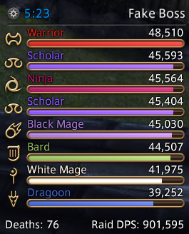
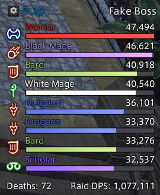
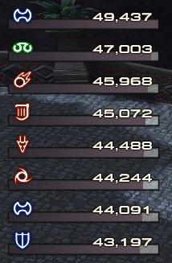
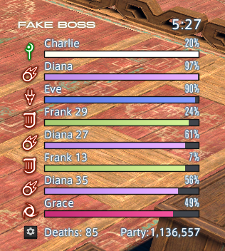
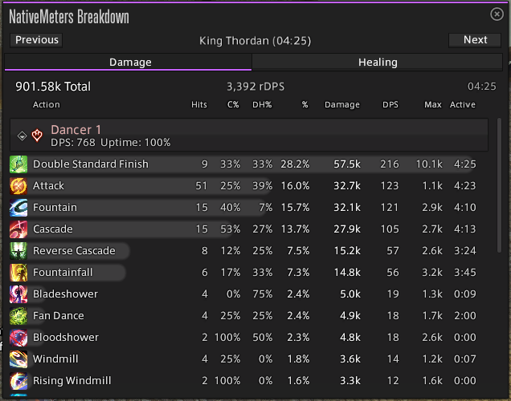
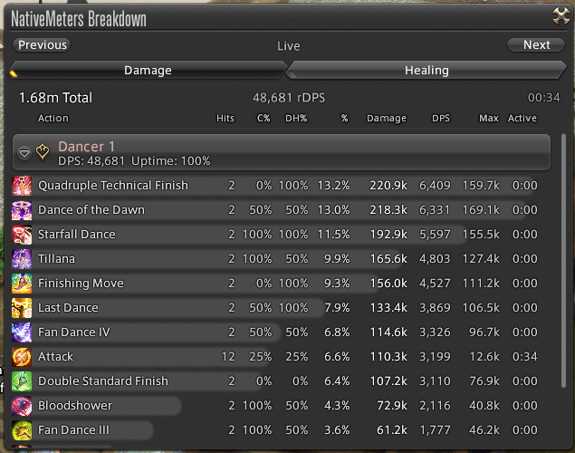

# NativeMeters

Meters that feel like part of the game. Who needs ImGui when you have AtkNodes?

  
  
  

## Description
Native DPS Meters for Final Fantasy XIV, this uses KTK.
You can fully customize the meters and their appearance (it will use any UI theme you may have installed through Penumbra).

> [!CAUTION]
> This plugin is in early development (beta) and may contain bugs and may reset your settings in the future (but I highly avoid that).

## Installation
1. Open the Dalamud settings by typing `/xlsettings` in-game.
2. Go to the **Settings** tab.
3. Add the following URL to your Custom Plugin Repositories:
   `https://raw.githubusercontent.com/Zeffuro/MyDalamudPlugins/master/repo.json`
4. Search for **NativeMeters** in the Plugin Installer.

## Translations

NativeMeters follows the FFXIV client language by default. To choose the plugin language independently, open **General → Language**. The settings window reopens in the selected language and saves your choice. The menu includes English, Japanese, German, French, Korean, Simplified Chinese (CN), and Traditional Chinese (TC).

To contribute a translation, edit the matching [RESX file](NativeMeters/Localization) and open a pull request. Simplified Chinese (CN) uses `Strings.zh-CN.resx` and Traditional Chinese (TC) uses `Strings.zh-TW.resx`. Preserve resource keys, format placeholders such as `{0}`, chat commands, and tags such as `[dps:c.1]`. Untranslated strings can be left out of the localized file to use the English text from `Strings.resx`.
